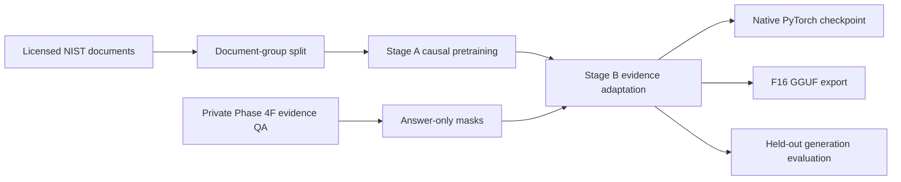

# CyberSLM-35M

CyberSLM is a scratch-built, 35.2-million-parameter decoder-only language model for evidence-grounded cybersecurity coursework. It was designed and trained locally by **Namgay D Wangchuk (25BTRCL300)** for the Design Thinking course at JAIN (Deemed-to-be University), assigned by **Dr. Sujeet S. Jagtap**.

> Research prototype, not a production detector. Generated answers, anomaly scores, and source annotations are not proof of an attack and must be checked against source evidence.

## Release status — 18 November 2026

| Component | Verified result |
| --- | --- |
| Architecture | 35,205,120 trainable parameters; forward/backward and checkpoint reload pass |
| Phase 4F evidence QA | 615 examples; 615/615 independently recomputed; all 68,027 source UUIDs accounted |
| Stage A pretraining | 1,000 steps; 2,048,000 token exposures; validation loss 1.205688; perplexity 3.3391 |
| Stage B adaptation | 100 steps; 21,968 answer-token exposures; best teacher-forced validation loss 0.058546 |
| Generation evaluation | validation EM 32.14%; cross-scenario EM 32.66%, numeric correctness 56.28% |
| GGUF / Ollama | F16 export imported and generated with Ollama 0.40.16; SHA-256 `d580042c919069ccf03bbe4327f8a60085f814a6ee5d432bde455bbf7b5aa831` |

The Stage B evaluation exposes a serious limitation: the model emitted only 11 unique predictions on each evaluation split and often repeated dominant training templates. Low teacher-forced loss does not demonstrate reliable free-form reasoning.

### Structured-QA improvement experiment

A later, preserved experiment adapted the same 35.2M architecture for 800 steps on 4,050
task-balanced fictional structured-QA examples. On a newly frozen, scenario-isolated holdout of
1,620 questions, the previous neural checkpoint scored 3.02% exact match and the improved neural
checkpoint scored 34.38% (95% Wilson CI 32.11%–36.73%). A separately labeled deterministic
evidence engine scored 100% (lower 95% bound 99.76%); that hybrid score is not neural accuracy.

The original improved GGUF used SentencePiece metadata for a raw byte tokenizer, causing spaces
to expand into three incorrect token IDs. The replacement merge-free GPT-2 byte vocabulary
restores exact input-token identity and achieved 180/180 task-balanced native-versus-Ollama
greedy output matches. See
[`reports/cyberslm_35m_structured_accuracy_v1.md`](reports/cyberslm_35m_structured_accuracy_v1.md)
for the frozen-test methodology, per-task results, hashes, error classes, and deployment receipt.

## Architecture

| Item | Value |
| --- | --- |
| Type | Decoder-only causal Transformer, trained from random initialization |
| Layers / width / heads | 10 / 512 / 8 |
| Feed-forward | SwiGLU, width 1,600 |
| Position / normalization | RoPE / RMSNorm |
| Attention | PyTorch SDPA with causal masking |
| Embeddings | Tied input/output embeddings |
| Tokenizer | UTF-8 bytes; 259 IDs: PAD=0, BOS=1, EOS=2, bytes=3–258 |
| Context | 512 byte tokens |
| Training aids | Gradient accumulation, gradient checkpointing, mixed precision |



## Data and provenance

Stage A uses ten public NIST publications listed in [`configs/stage_a_sources.json`](configs/stage_a_sources.json). Eight documents are assigned to training and two to validation at `document_id` level. No validation document contributes training bytes. The packed corpus contains 5,358,977 train tokens and 179,218 validation tokens; its Parquet SHA-256 is `b9e6bd8b526a0b3c0360c325c241eee45401e4af2c7268f51bb6f2fadc848ac0`.

Stage B uses the private Phase 4F evidence-QA artifact: 388 train, 28 validation, and 199 cross-scenario examples. It is not published because source release rights were not established. The public Hugging Face dataset is instead a six-row, unmistakably fictional schema/demo fixture using `.invalid` domains. It must not be presented as the training corpus.

Raw reports, production Parquet files, secrets, checkpoints, and experiment binaries are excluded from Git. Research runs record corpus, tokenizer, configuration, seed, code revision, and artifact hashes.

## Training results

### Stage A — licensed cybersecurity language pretraining

- Checkpoint SHA-256: `cea167c1bd0d3709d3e912d00e26c885ccaae10202bb5622a96b6601d9f526b6`
- 1,000 optimizer steps; 2,048,000 token exposures; 0.3822 effective corpus passes
- Validation loss 1.205688; byte perplexity 3.3391
- NVIDIA GeForce RTX 4050 Laptop GPU; 751.64 seconds; 2,724.71 tokens/second
- Peak allocated CUDA memory: 723,383,808 bytes

### Stage B — limited-data evidence adaptation

- Checkpoint SHA-256: `a86577065a5ab95ac76d82ffbefc3b4a60769ec493b03e2e3d3b22954adb9d94`
- 100 optimizer steps; 21,968 answer-token exposures; 1.0309 effective example epochs
- Duration 159.69 seconds; peak allocated CUDA memory 1,147,436,544 bytes
- Validation: 28 examples, 32.14% exact match and numeric correctness
- Cross-scenario: 199 examples, 32.66% exact match and 56.28% numeric correctness
- Unsupported-claim rate: 0% on both evaluated splits

The cross-scenario set was used during development and is not a pristine final benchmark. These are task-template metrics, not attack-detection precision, recall, F1, or attribution.

## Reproduce the bounded code path

```powershell
python -m venv .venv
.\.venv\Scripts\Activate.ps1
python -m pip install -e ".[dev]"
$env:PYTHONPATH = "src"

python scripts\build_stage_a_corpus.py --sources configs\stage_a_sources.json --output-dir data\stage_a\cyberslm_stage_a_nist_v1
python scripts\train_stage_a.py --config configs\training\cyberslm_35m_stage_a.yaml
python scripts\train_stage_b.py --config configs\training\cyberslm_35m_stage_b.yaml
python scripts\evaluate_checkpoint_qa.py --help

# Structured-QA improvement run
python scripts\build_structured_qa.py --seed 2031 --output-dir data\structured_qa\cyberslm_structured_qa_v1
python scripts\train_stage_b.py --stage-a-checkpoint outputs\cyberslm_35m_stage_a_nist_v1\checkpoints\step_001000.pt --dataset-dir data\structured_qa\cyberslm_structured_qa_v1 --output-dir outputs\cyberslm_35m_stage_b_structured_v1 --training-config configs\training\cyberslm_35m_stage_b_structured.yaml
python scripts\evaluate_structured_qa.py --checkpoint outputs\cyberslm_35m_stage_b_structured_v1\checkpoints\final_step_000800.pt --dataset data\structured_qa\cyberslm_structured_qa_v1\cross_scenario_test_qa.parquet --output-dir outputs\cyberslm_35m_stage_b_structured_v1\evaluation\cross_scenario_test
```

Review the corpus manifest and source/license record before training. Do not commit generated data. Run the quality gates before contributing:

```powershell
python -m ruff check src scripts tests
python -m mypy
python -m pytest -q
```

## Native model loading

The Hugging Face package contains custom PyTorch code and an inference state dictionary; it does **not** claim `AutoModelForCausalLM` compatibility:

```powershell
python load_model.py --prompt "Cybersecurity risk management requires" --max-new-tokens 64
```

## GGUF and Ollama

The improved hosted package contains `cyberslm-35m-structured-byte-f16.gguf`. Download it beside
`ollama/Modelfile.structured-byte`, then run:

```powershell
ollama create cyberslm-35m-structured-byte -f .\ollama\Modelfile.structured-byte
ollama list
powershell -NoProfile -ExecutionPolicy Bypass -File .\presentation\Run-CyberSLM-Demo.ps1
```

The fixed GGUF SHA-256 is
`60d8e46194ea05b9be52c7d06538113a29bb4e8bb72db63c404637e64ca4ea40`.
Ollama 0.40.16 registered it as `cyberslm-35m-structured-byte:latest`. The earlier
`cyberslm-35m-structured:latest` and `cyberslm-35m:latest` registrations remain available as
fallbacks. Token IDs matched exactly on the diagnostic prompt, top-ten first-token log
probabilities agreed within approximately `1e-3`, and greedy strings matched on all 180
task-balanced parity prompts. This verifies the tested runtime path, not the model's answer
correctness; frozen-test neural exact match remains 34.38%.

## Repository map

- `src/cyberslm/` — model, tokenizer, data, training, demo, and GGUF export modules
- `scripts/` — corpus, validation, training, evaluation, export, and packaging entry points
- `configs/` — frozen architecture, sources, and bounded training configurations
- `tests/` — unit and integration tests
- `docs/` — architecture, validation, experiment, and limitation records
- `presentation/` — verified demonstration checklist and runbook
- `app/` — local Streamlit evidence demonstration

## Public releases

- GitHub source: <https://github.com/namgaydw-tech/CyberSLM>
- Hugging Face model: <https://huggingface.co/namgaydw-ai/CyberSLM-35M>
- Public synthetic dataset: <https://huggingface.co/datasets/namgaydw-ai/CyberSLM-Evidence-QA>

Consult the remote revision history and presentation checklist before describing a remote artifact as verified.

## Academic and safety limitations

- Phase 4F and earlier THEIA-derived artifacts are not released without recorded authorization.
- Synthetic fixtures are fictional and are never reported as observations.
- `ATTACK_CANDIDATE` annotations and anomaly scores are review signals, not confirmed attacks.
- Low language-model loss can coexist with memorized answer templates.
- This model must not autonomously block systems, attribute actors, or make incident verdicts.
- The structured holdout is scenario-grouped and frozen, but multiple-seed training and
  evaluation on independently authorized observational records are still required before
  stronger generalization claims.

See [`docs/experimental_results.md`](docs/experimental_results.md), [`docs/dataset_validation.md`](docs/dataset_validation.md), and [`docs/remaining_limitations.md`](docs/remaining_limitations.md) for the audit trail.
