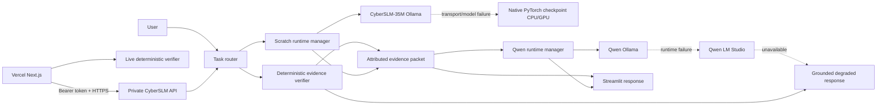

# CyberSLM fault-tolerance and Vercel verification — 20 November 2026

## Outcome

The local system now separates scratch inference, deterministic verification, Qwen explanation,
and UI. The original `cyberslm-35m-structured-byte:latest` remains unchanged. Qwen uses Ollama
first, LM Studio second, and raises a structured unavailable result when neither runtime is ready.
Scratch inference uses its Ollama model first and the verified native PyTorch checkpoint second.

The separate Vercel app provides live deterministic evidence parsing/verification. Remote model
inference is deliberately unavailable until an authorized HTTPS backend is configured. It never
uses localhost from Vercel and never substitutes a fixed response.

## LM Studio root cause

| Finding | Evidence | Classification | Correction |
| --- | --- | --- | --- |
| Port 1234 originally refused connections | `lms server status` reported stopped; direct request failed | Verified | Started `lms server start --port 1234` |
| No model was loaded | `lms ps` initially returned no models | Verified | Loaded Qwen with identifier `cyberslm-practical`, 8,192 context |
| Request schema works | Direct `/v1/chat/completions`, `practical_chat`, and router calls all returned meaningful output after startup | Verified | Adapter retained OpenAI-compatible schema; timeout is configurable |
| Identifier is correct | `/v1/models` exposed `cyberslm-practical` | Verified | Runtime manager checks the live model list before inference |
| GPU contention caused the original failure | Ollama had no loaded model during diagnosis | Not demonstrated | Do not claim this cause; avoid unnecessarily preloading both Qwen copies |

The observed root cause was service lifecycle (stopped server and unloaded model), not tensor,
chat-template, or response-schema incompatibility.

## Architecture



## Exact communication boundary

- `src/cyberslm/two_model_bridge.py:214` — `run_bridge()` owns orchestration.
- `src/cyberslm/two_model_bridge.py:330` — constructs the attributed evidence packet.
- `src/cyberslm/two_model_bridge.py:340` — serializes that packet into Qwen's prompt.
- `src/cyberslm/two_model_bridge.py:360` — selects injected test adapter or fault-tolerant Qwen.
- `src/cyberslm/two_model_bridge.py:364` — sends the packet to Qwen.
- `src/cyberslm/runtime_manager.py:148` — validates and tries Qwen providers in order.
- `src/cyberslm/runtime_manager.py:226` — tries scratch Ollama then native PyTorch.

Line numbers refer to this report's reviewed revision and may move in later edits.

## Live results

- Checkpoint SHA-256: `72185b281de6baaf80003d8bdf5cbd4e2af9602f596a01b4308ef978f314f675`.
- Native CPU versus preserved scratch Ollama: 3/3 exact (`2`, `2`, `NO`).
- Forced Qwen Ollama transport failure: LM Studio recovered and answered through
  `cyberslm-practical`.
- Authenticated local API: `/health`, `/v1/chat`, and `/v1/bridge` returned live results.
- A live off-topic bridge explanation was observed and then fixed: the grounding gate now replaces
  verbose/irrelevant or unsupported Qwen prose with the independently computed summary.
- Next.js: lint, strict TypeScript, 2 tests, production build, and headless Chrome UI smoke passed.
- A fresh index reconstruction loaded the same 1,605 public documents, produced 6,948 chunks,
  reproduced the embedding SHA-256 `56e0840978e8b30091c142dfddd930e83a0b2c185e2cf256b63e3fed7d3dc766`,
  and finished with `status: PASS`. The Parquet file-byte hash changed under newer
  pandas/pyarrow serialization; this is why content/source receipts, not only container bytes,
  matter for reconstruction.

The JSON live receipt is intentionally ignored under `outputs/` and can be reproduced with:

```powershell
python scripts\diagnose_runtime_failover.py --output outputs\runtime_failover_latest.json --device cpu
```

## Security and limitations

- The deterministic input gate blocks malformed event labels and never treats retrieved text or
  event fields as instructions. Retrieved prompt-injection-like lines are removed before prompting.
- The request safety gate covers explicit credential theft, token/password dumping, ransomware or
  malware deployment, defense evasion, and destructive wiping. It is keyword/regex defense in
  depth, not a complete semantic safety classifier.
- The Qwen grounding check is heuristic; human review remains required.
- Native/Ollama parity here covers three supported presentation questions, not every token sequence.
- Provider recovery is per-request and bounded to one attempt per configured provider; there is no
  infinite retry loop.
- Vercel's in-memory rate limiter is per function instance, not globally distributed. A platform
  firewall rule or shared store is required before higher-risk public use.
- Vercel model inference remains **blocked** until an authorized, authenticated remote HTTPS backend
  exists. Local Ollama and LM Studio cannot be reached from Vercel.
- Parquet on Vercel is limited to 1 MB and 10,000 records; private datasets must not be uploaded.

## Reproduction

See `presentation/CYBERSLM_FAULT_TOLERANCE_RUNBOOK.md` and
`vercel_app/README.md`. No training, checkpoint rewrite, GGUF rewrite, or model deletion is part of
this change.
